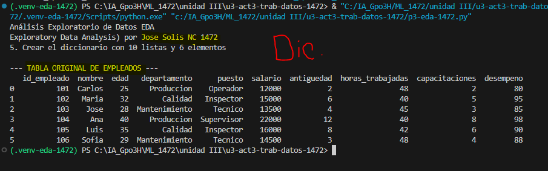
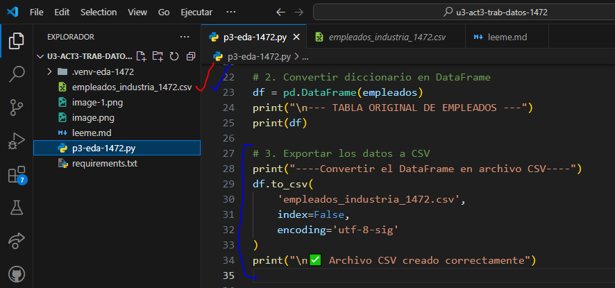
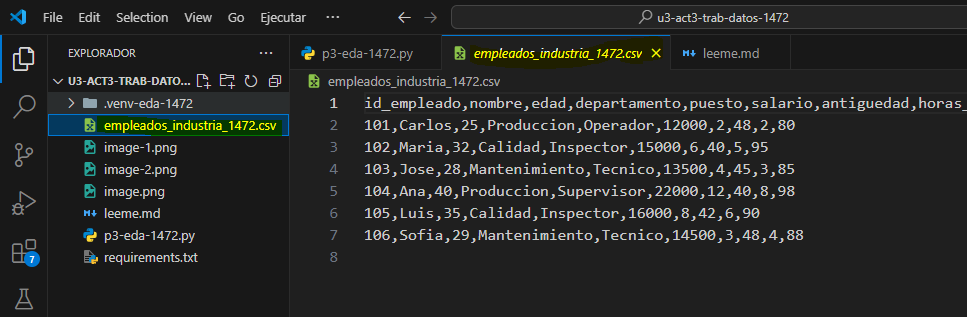

# 📊 UIII Act3: Importación y Descripción de Datos

> **🎓 Asignatura:** Soluciona problemas de Machine Learning  
> **📚 Nivel:** Tercer semestre de preparatoria  
> **🤖 Especialidad:** Inteligencia Artificial  
> **📈 Dificultad:** Cero a principiante  
> **🐍 Lenguaje:** Python  
> **🛠️ Herramientas:** Visual Studio Code, Pandas, Matplotlib y CSV

## tabla original de empleados

## 7. Convertir el DataFrame en archivo CSV

## datos en csv --> base de datos

